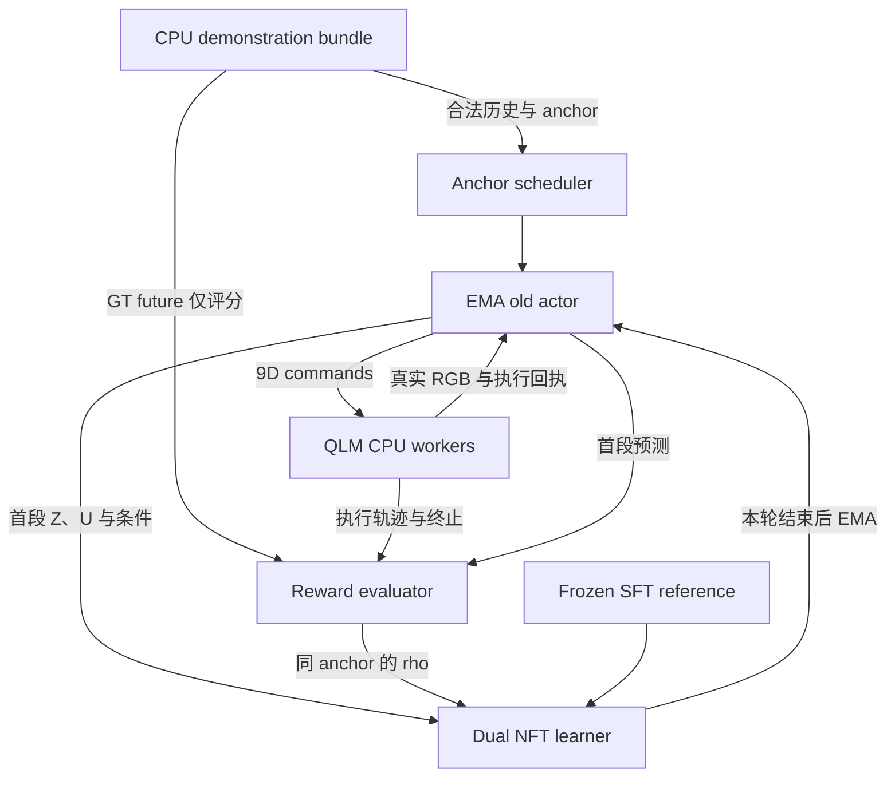

# WAM-Policy RL-v2 完整实现方案

**GT-guided chunk-level closed-loop Dual DiffusionNFT**  
**日期：2026-10-25**  
**算法依据：** 用户提供的 `RL-v2_GT-guided_Close-loop_Dual-NFT_algorithm_design.md`，Revised Method v2.0。  
**交接对象：** 后续负责 WAM-Policy 与 QLM-Bench 开发的 Codex。  
**范围：** 将已确定的算法转成模块职责、数据契约、运行流程、阶段依赖及验收条件；不规定具体类、函数、代码补丁或启动命令。

## 1. 实施结论与固定范围

RL-v2 应建设为一个由 WAM-Policy 负责优化、QLM-Bench 负责真实执行的训练系统。关键依赖顺序是：**同一 CPU 环境下的成功 GT replay → 可复现的完整 anchor restoration → 正确条件下的多 candidate 闭环采样 → 可区分的 dense reward → 首个 joint chunk 的双条件 NFT → 正常任务初态的完整评测。**

这条路线复用现有四足 SFT 模型、完整 video-to-action sampler、执行回执、真实 feedback 和任务判据；主要新增可恢复训练起点、reward、endpoint buffer、NFT learner，以及 trainable/EMA old/reference 的生命周期管理。[S1–S8]

### 1.1 两个仓库与开发分支

| 仓库 | 基础分支 | 本轮核对的基础 commit | 待创建的开发分支 |
| --- | --- | --- | --- |
| `JalenLoong/WAM-Policy` | `adaptation/v2-mujoco-sft` | `e26d1ef0db9423af2e797abca8026af4bdec495e` | `rl/v2_GT-guided_chunk-level_close-loop_NFT` |
| `JalenLoong/QLM-Bench` | `migration/mujoco-foundation` | `5954235ae75d787eef6af44d58594fd48bde51be` | `rl/v2_GT-guided_chunk-level_close-loop_NFT` |

两条新分支分别从各自的基础分支创建，不跨仓库复用分支基点。实际开始开发时核对基础分支是否变化；若有变化，记录新的基点并复核受影响接口。每次可运行交付都绑定两个仓库的精确 commit，而不是只写相同的分支名。

本文件是实现方案。本次工作只读核对了仓库和资料，没有创建上述分支、修改仓库实现或启动训练。

### 1.2 首版必须保持的算法约定

| 项目 | 首版实现约定 |
| --- | --- |
| 初始化 | 所选 MuJoCo quadrupedal Adaptation v2 SFT checkpoint |
| 模型输入 | 已有双视角 RGB、任务指令和合法 executed-action history |
| 动作 | 原顺序的 9D RAMBO high-level commands |
| 训练起点 | 仅 training split 的成功 demonstration 所派生的 anchors |
| Anchor 抽样 | 每条 demonstration 最多 8 个 temporal strata，区间内动态抽样 |
| 单 demo 初始批量 | 全局 B=2 anchors；每 anchor G=4 candidates |
| Reward horizon | 可配置 H 个真实执行 chunks；先 H=1 |
| 更新窗口 | 只更新首个 joint chunk 的 video/action endpoints |
| Reward | 0.70 execution + 0.25 video + 0.05 action |
| 采样策略 | 本轮固定版本的 EMA old policy |
| 稳定约束 | Frozen quadrupedal SFT reference 的 velocity regularization |
| 环境设备 | MuJoCo physics、rendering、RAMBO 及其控制计算全部 CPU |
| 正式评测 | 正常任务初态、完整 closed-loop episode |

本轮以 Adaptation v2 为实现对象，不新增 v3 proprioception 输入，不改 RAMBO，不改变 task success predicate。AnyFlow/OPD 的 teacher-student 蒸馏与 NFE 压缩不进入首版 RL 目标；后续若单独引入，应保持与本次 RL 效果判断相互独立。

## 2. 现有代码的真实起点

### 2.1 可以直接继承什么

| 能力 | 核对结果 | RL-v2 的处理 |
| --- | --- | --- |
| 四足 SFT 与完整评测 | 仓库已有 MuJoCo step5000 的正式评测记录；v2 Standard100 为 77/100 success | 使用正式 checkpoint；旧结果作为背景，同 CPU profile 重新建立对照 |
| Video → action sampling | 当前 WAM sampler 已完成 full video denoising 后再采 action | 沿用该语义，新增 clean endpoints 与实际 conditioning 的导出 |
| 真实 feedback | 执行后用实际 RGB 与 executed commands 替换 predicted KV | 复用；扩展至 anchor 起点和隔离的 candidate sessions |
| CPU 仿真 | Generic QLM runtime/evaluation 支持 Native MuJoCo、CPU RAMBO、OSMesa | 显式绑定此组合并完成运行环境验收 |
| 任务状态与回执 | 已有 progress、success/fall/timeout、partial execution、terminal-before-reset | 复用其判据和事件，补足 snapshot 与 RL score coverage |
| 训练基础设施 | 已有 single/DDP、混合精度、梯度检查与 checkpoint 基础 | 复用底层设施，新增独立 RL loop 和 resume contract |

上述现状分别可从当前 inference、live/runtime、训练模块和 2026-10-21 评测文档确认。[S1–S9]

### 2.2 必须补齐的缺口

1. **PhysicalTrace 不是完整 resume snapshot。** 现有 trace 和离线录像重建可恢复画面，但不包含完整 controller/task/RNG continuation state。[S10–S11]
2. **普通 episode reset 不能用于中途 anchor。** 当前 reset 清空历史并要求时间从零开始；直接写入中段 qpos/qvel 不等于恢复 demonstration 状态。[S7–S8]
3. **当前 standard evaluation suite 强制 EGL。** 该 suite 拒绝软件 renderer；须派生明确的 CPU OSMesa evaluation profile。[S12]
4. **当前 sampler 对外主要返回执行 commands。** NFT 还需要未替换、未反推的 normalized action endpoint U、clean video Z，以及 action 采样时真正使用的 video condition。[S1]
5. **SFT batch preparation 不是 NFT batch preparation。** SFT 默认 teacher forcing、随机 chunk/window 和 noisy-history augmentation，不能原样用于已采样候选的条件重建。[S2–S3]
6. **没有现成的 Dual-NFT 生命周期。** 同批 old 版本固定、三角色 prefix、group-relative reward、首段 buffer、EMA 边界都需新增。

旧 `model/adaptation-v2.md` 等文档中的 720p、早期 not_run 描述有其历史范围；本方案以当前 MuJoCo checkpoint、360p profile、源码和最新评测记录为准。[S4–S6]

## 3. 系统职责与训练拓扑

### 3.1 职责分配

| 所属 | 模块 | 输入与产出 | 主要职责 |
| --- | --- | --- | --- |
| QLM-Bench | CPU environment profile | 资源、task、camera、controller 配置 → 可执行环境 | 固定 NativeCPU + RAMBOCPU + OSMesa |
| QLM-Bench | Demonstration replay | 原初态与 GT commands → CPU GT trajectory | 真实重新执行、生成 reference observations 与完整 snapshots |
| QLM-Bench | Anchor store / restoration | Anchor handle → simulator/controller/task 状态 | 中途恢复与 candidate 隔离 |
| QLM-Bench | Environment workers | Requested native9 → RGB、execution ack、task status | 执行、计时、终止及故障报告 |
| QLM-Bench | CPU full-episode evaluation | 固定 cases + policy → trial records | 正常初态下的任务评测 |
| WAM-Policy | History adapter | 合法 prefix/真实反馈 → VAE history 与模型条件 | 时间相位、global positions、VAE/KV 恢复 |
| WAM-Policy | EMA sampling actor | Anchor history → 首段 endpoints 与 H-chunk candidates | 两阶段自主采样，真实闭环 continuation |
| WAM-Policy | Reward evaluator | GT references + candidate artifacts → 三类分数及 rho | 指标、尺度、终止聚合、组内比较 |
| WAM-Policy | Dual-NFT learner | 首段 endpoints/conditions/rho → 参数更新 | 正确条件下的双 loss 与 reference regularization |
| WAM-Policy | Coordinator / checkpoint manager | 全局配置与状态 → 完整 outer iterations | 抽样、版本屏障、统计、保存、恢复 |

这里的模块名称表示职责，不预先规定代码目录或类接口。QLM 保持 policy-independent，不导入 WAM backbone、diffusion latents 或 NFT loss。WAM 不实现第二套 task success 逻辑。

### 3.2 首版采用同步 outer loop

先固定一个 old version，完成本轮全部 anchors/candidates，收齐 reward 后再执行 learner 更新，最后执行一次 EMA。Sampling actor 和 learner 可以分时使用训练 GPU；逻辑角色分开不意味着必须购买或常驻三套独立 GPU 服务。

首轮可只用一个 CPU worker 顺序完成全部 candidates。G=4 表示四个候选，不要求四个并发环境；B=2 也不要求八个同时运行的 workers。并发是性能参数，不改变算法批量。

## 4. 必须冻结的模型、数据和时间契约

### 4.1 初始化与资源身份

首先绑定经过正式 SFT 的 Adaptation v2 checkpoint，附带其 normalizer、RGB preprocessing、任务 instruction/prompt embedding、VAE/T5 和模型配置。拒绝将“从 native30 转换为 native9 的初始化权重”当成已经完成四足 SFT 的模型。[S5]

当前 MuJoCo SFT 数据记录为 1000 episodes、800/100/100 train/validation/test；RL 通过明确的 episode/physical-trajectory lineage 读取 train 集，不能因存在多个 rendition 就把同一物理 demonstration 拆到不同数据分区。[S6]

每次训练记录两仓库 commit、SFT checkpoint hash、数据 revision/split、normalizer、controller、场景/资产、camera、snapshot schema、reward calibration 和 sampler 配置的身份。资源缺失时允许先完成接口和小模型工程验证，但不能把它算成真实 SFT policy 的 RL 验证。

### 4.2 当前 MuJoCo 的时间单位

| 层次 | 当前接口 | 一个普通 joint chunk |
| --- | --- | --- |
| Physics | 500 Hz；2 ms | 160 physics steps |
| RAMBO | 100 Hz；10 ms | 32 controller steps |
| High-level commands | 50 Hz；20 ms | 16 条 native9 commands |
| Raw policy RGB | 50 Hz，保留原始数据契约 | 原始轨迹按其真实 timestamps 记录 |
| 模型 RGB | 12.5 Hz；80 ms | 4 个新采样时刻 |
| Future video latent | 因果 VAE temporal packing | 1 个 future latent group |
| 实际时长 | — | 0.32 s |

若 anchor 位于 t_a，则该 chunk 的命令覆盖 [t_a, t_a+0.32s)，模型反馈时刻是 t_a+0.08/0.16/0.24/0.32s。时间来源是 simulator 的整数 tick/ns；wall-clock inference latency 不进入物理时间轴。[S1,S7,S13]

初始 RGB 单独编码的 initial latent，其 16 个 action slots 是 mask=false 的占位，不是一次真实动作 chunk。SFT 内部随机 attention chunk_size 与 RL 的环境 chunk/H 分别管理。

### 4.3 Camera、VAE 与 history

当前 MuJoCo profile 是 `dual-rgb-360p-v1`：go2_ego、d435i_rgb_task 两路 640×360 RGB；模型仍按全 episode phase0 每四帧采样，resize 到 320×180，上下各加 6 像素，进入冻结 causal VAE。每路 latent 为 48×T×12×20，双视角按既定空间布局组合。[S4,S14]

Anchor 中段不能把一张当前图像作为新 episode 首帧重新编码。必须恢复或重建两视角各自的 causal VAE encoder state、合法 prefix、global latent/position index 和模型的已执行动作历史。Frozen VAE/T5 输出可在资源身份一致时复用；Transformer 的 KV 依赖 policy 参数，不能跨 current/old/reference 复用。

Video reward 的 decoder 同样需要合法 causal prefix 或经过验证的 decoder state。不能假定一个非初段 latent 独立 decode 就自动对应四个正确 future frames。首版用合法历史重建作为正确性基准，之后再优化缓存。

### 4.4 动作及 force-zero

动作顺序保持 `[v_x,v_y,omega_z,p_x_FL,p_y_FL,p_z_FL,f_x_FL,f_y_FL,f_z_FL]`，坐标系、绝对 EEF target 语义和 affine normalizer 全部继承 checkpoint/runtime。

当前执行路径会做 float32 量化，并把最后三维 desired force 强制设为零；filter 为 identity，没有代码依据宣称已有额外 high-level clipping。[S15]

因此首版保持 9D shape，但 Action reward 与 reward-driven Action NFT 的 controllability mask 只覆盖前六维，velocity/position 两组各占 0.5。固定 force 维可以保留 frozen-reference 的稳定约束，但不得贡献奖励驱动的偏好学习。真实 contact force 是测量状态，不能拿来代替 desired-force command。

保留三个层次：**normalized sampled U → requested physical command → execution-confirmed command**。NFT endpoint 始终是第一项；Action reward 比较合法 requested physical commands；下一步 history 读取实际确认执行的第三项。

## 5. CPU demonstration replay 与 anchor 数据准备

### 5.1 首个验证任务

建议首先选择 `push_box`，从所选 checkpoint 对应 train 集挑选一条成功且内容完整、覆盖接近与接触过程的 demonstration。目标是跑通算法闭环，不把单 demo 结果当作任务泛化证据。若该 demonstration 无法在目标 CPU 环境成功重放，应先解决来源或物理一致性问题，或选择另一条合格 train demonstration。

### 5.2 区分两种 replay

**Render replay** 将保存的物理状态逐帧送入 renderer，只证明可以重建图像。**Command replay** 从 episode 初态出发，经 RAMBO 真正执行 GT commands，才会产生可继续仿真的 controller/task 状态。RL anchors 必须建立在后者之上。

现有 PhysicalTrace 含 scene initial state、seed、commands 和状态/telemetry，可作为 command replay 输入；现有离线 `record_trace` 明确不重新执行 physics/controller，不能直接交付 RL anchors。[S10–S11]

### 5.3 预处理流程

1. **确定来源。** 固定原 demonstration 的 physical episode、train split、原物理 backend、任务/资产/controller、camera、commands 和时间戳。
2. **构建目标 CPU 环境。** Native MuJoCo physics + CPU RAMBO + OSMesa；使用与 learner rollout 相同的场景和 observation profile。
3. **从初态真实重放。** 逐条提交原 GT requested commands，通过正常变换与 ack 路径完成执行。同步记录实际 executed commands、RGB、状态、任务进展及 terminal。
4. **检查重放质量。** 比较原轨迹和 CPU 轨迹的物理/控制/时间差异，确认 CPU replay 成功。原轨迹若来自 MJWarp，不预设跨 backend 逐点一致。
5. **创建 CPU RL reference。** 如果 CPU replay 成功且保持冻结的任务语义，可建立有原 demo 父来源的新 CPU demonstration 版本；不覆盖原 SFT 数据，不把差异隐藏成“完全同一轨迹”。不成功的 replay 不能接纳为成功 GT。
6. **在合法 joint-chunk 边界生成 snapshots。** 保存所有准备支持动态采样的可恢复边界，不只存永久固定的八个状态。
7. **生成 WAM prefix 与 reward targets。** 同一次 CPU trajectory 生成 history、GT actions、RGB、时间映射、冻结 VAE latents 和必要 reconstruction。
8. **完成 restore + GT continuation 验收。** 与不中断的 CPU replay 比较后续状态、commands、RGB、timestamps 和 task 事件。

若原 GT 是 EGL 渲染，应单独生成同一 OSMesa profile 的 reference rendition。这样 Joint reward 比较的是同一 renderer 下的真实轨迹差异，避免把 EGL/OSMesa 外观差异当成策略误差。

### 5.4 两种恢复路径

早期允许“从 episode 初态 replay 到 anchor”作为正确性基准。它天然恢复了控制历史，但前缀执行成本必须计入统计。

正式训练优先使用完整 snapshot 直接恢复。它的验收参照是上述真实 replay，不以“初始画面看起来一样”作为通过标准。若快照尚未验收，训练入口只允许明确的 replay 恢复模式，不自动启用不完整 snapshot。

## 6. 完整 snapshot 与中途恢复

### 6.1 Snapshot 的内容边界

| 层次 | 必须覆盖的状态 |
| --- | --- |
| MuJoCo | 完整 integration state，包含实际使用的 warmstart、control、applied forces、act、mocap、constraints、time 等输入 |
| RAMBO | Observation history、上次 residual、command references、gait/contact phase、IK/filter 状态、motor delay buffer/cursor/lag/age、必要中间状态 |
| Physics adapter | MuJoCo integration state 以外的 contact_history、contact_history_tick，以及影响下一步控制输入的适配层状态 |
| QLM 时钟 | 原 episode absolute tick/ns、controller/policy tick、capture phase、elapsed time |
| Task | Success hold、progress 的原始几何参照、任务 latch/阶段状态、last-evaluated tick、终止标志 |
| RNG | 环境与控制器各随机流的完整状态；仅 seed 或状态 hash 不够 |
| 执行账本 | 已完成 commands、当前有效区间、必要 command/reference identities |
| Observation | Sensor frame IDs、renderer freshness、用于重新采样的相位 |
| 固定身份 | Scene/assets/controller/task/camera/physics 参数与 snapshot schema |

MuJoCo 官方把 integration state 定义为 forward dynamics 所需输入的集合，并特别说明 warmstart 对中途精确数值重现的影响。项目还必须额外保存 MuJoCo 之外的 RAMBO、task 和随机状态。[S16]

Snapshot 在 chunk 边界、上一组执行完整确认后、下一组尚未提交时建立。首版不支持任意 controller-step 中间存档，以减少不明确的 in-flight command 状态。

### 6.2 三个时间和身份概念

必须同时保留：原 episode 的 absolute simulation time、当前 clip 的 relative elapsed time、新 candidate 的 session/restore identity。新 session 用来隔离请求和缓存，不意味着把原 task elapsed time 或 success hold 清零。

恢复过去时间点需要新的 renderer freshness epoch，不能删除现有反向 tick/旧 epoch 检查来绕过状态一致性。restore 本身不推进物理时钟，也不消耗未经声明的 controller RNG。

### 6.3 WAM history 的独立恢复

永久 anchor 存原始合法历史或可重建 prefix，而不是一套跨训练阶段永久有效的 Transformer KV。每个 policy version 分别用自己的权重构建其条件特征。

同一个 old version 内，同一 anchor 的 immutable prefix 可以共享；每条 candidate 拥有自己的后续 cache、VAE state、生成 RNG 和 feedback ledger。候选之间不能共享可写 session state。

## 7. Anchor 抽样与 candidate 调度

### 7.1 八个 strata 是八个时间区域

对每条 demonstration 的可恢复合法起点按时间排序，划为 M=min(8,N_valid) 个尽量等数量的连续区间。每次访问某一区间，均匀抽一个实际 chunk boundary。

单 demo 初始 B=2、G=4：打乱 strata 顺序，每轮访问两个不同区间；M=8 时四轮覆盖一遍，再重新打乱。M 小于 B 时显式降低本轮有效 anchor 数，不能复制同一 anchor 冒充两个不同 strata。循环末端的余项继续按无重复语义处理。

Stratum 的访问次数、实际 anchor、有效 preference group 和实际 optimizer contribution 分别计数。基础设施失败重试不额外推进抽样游标；恢复训练时保存 permutation、cursor 和 RNG。

### 7.2 Horizon 与尾部

同一 anchor 的全部 candidates 使用相同 nominal H_n。它由配置 H、剩余合法 reference chunks 和已知任务时间覆盖共同确定。

首版优先把完整 future latent/16-command group 的边界纳入 anchor 集合，源数据不足完整 packing group 的尾部继续保存并标注，不补 fake action 或 fake RGB。靠近尾部时 H_n 缩短；无至少一个合法首段的起点不进入训练 anchor 集。

这里的 H 只扩展 reward lookahead。即使 H=3，NFT buffer 仍只保存首段 Z、U 和条件，不能把后两段自动加入 loss。

### 7.3 Candidate 的公平比较

一个 candidate group 的身份至少包含 task、CPU demo version、anchor、old policy version 和 sampler profile。每条 candidate 恢复相同环境/controller/task/RNG 起点与相同 history；生成噪声独立，并记录独立随机流。

不按同一句 instruction 把不同物理 anchors 合组，不在一个组内混用不同 H、不同采样步数或不同 old 版本。

## 8. H-chunk 真实闭环采样

每条 candidate 的运行顺序固定如下。

1. 恢复 anchor，构造该 old policy 的合法 history。
2. 从 history 自主生成完整 clean video endpoint Z。
3. 以该 history 和真正生成的 predicted-video representation 为条件，自主生成 normalized action endpoint U。
4. 按冻结 normalizer 解码 requested native9，交给 CPU RAMBO 环境执行。
5. 收取真实 RGB、完成执行的 command ack、partial/terminal 信息和物理 timestamps。
6. 删除或替换临时 predicted cache，用真实 feedback 更新 history。
7. 若尚未结束且 j+1<H_n，继续下一 joint chunk；下一段不注入 GT future。

当 j=0 时保存 detached Z、U、原始 history 及实际 video condition，并计算 Video/Action reward。后续 chunks 只为 Joint reward 提供真实执行后果。后续 predicted video 仍须生成以条件化 action，但可以不为 reward 额外 decode；只有首段 Video reward 必须得到其正确 RGB。

首版明确使用 **full-clean-video mode、video/action NFE=25/50、CFG=1、window_units=8**，对应已知 MuJoCo SFT 推理配置。代码类默认的 5/10 不自动覆盖此运行配置。[S1,S17]

若未来引入 partial denoising，则必须另行保留 Z_cond 与 Z_clean、action conditioning 的实际 noise/time metadata，并完成条件等价性验收；不在首版混入该额外适配。

### 8.1 Policy-visible 与 reward-only 数据

| 数据 | 首段 actor | Continuation actor | Reward evaluator | NFT learner |
| --- | --- | --- | --- | --- |
| Task instruction | 可见 | 可见 | 可见 | 条件 |
| Anchor 的合法历史 | 可见 | 作为已有历史 | 可见 | 首段条件 |
| Learner 实际 observation/ack | 当前发生前不可见 | 已发生后可见 | 可见 | 只作审计，不能改写首段原条件 |
| GT future RGB/action | 不可见 | 不可见 | 可见 | 不作为 candidate 的条件或 endpoint |
| 完整 simulator privileged state | 不输入 v2 模型 | 不输入 v2 模型 | Task/diagnostics 可使用 | 不新增模型输入 |
| 首段 sampled Z/U | 生成结果 | 按实际执行规则替换历史 | 评分对象 | Detached training samples |

## 9. Reward 的工程化定义

### 9.1 三项 reward 保持不同作用范围

| 分数 | 比较对象 | 范围 | 权重 |
| --- | --- | --- | ---: |
| R_J | 真实 CPU execution observations vs CPU GT observations | H_n chunks | 0.70 |
| R_V | 首段 decoded predicted video vs 对应 GT video/reconstruction | 首段 | 0.25 |
| R_A | 首段 requested physical commands vs GT commands | 首段 | 0.05 |

先得到 R=0.70R_J+0.25R_V+0.05R_A，再进行同 anchor 的相对比较。R_J 不改成 predicted-vs-executed consistency，不把 task progress、接触力或 smoothness 临时加入第四类 reward。

### 9.2 视觉指标与标定

两视角先分别按真实 timestamps 对齐，再按有效帧计算 MAE 与 LPIPS，经固定尺度归一化后组合并取 exp(-distance)。两个 policy views 等权，MAE/LPIPS 初始各占 0.5。

首版 R_J 明确使用与 live feedback 一致的 **12.5 Hz 全局相位网格**，每个完整 chunk 四个新时刻；GT 从 CPU reference 的对应时间提取。Raw demonstration 仍按原契约保存 50 Hz RGB。这样无需另建 50 Hz 在线 reward stream，也不会把四帧反馈误认为完整 50 Hz 录像。

完整 chunk 先按算法得到一次 S_vis=exp(-该 chunk 内的平均加权距离)，再在 clip 层按 gamma 对 chunk 分数做归一化平均。不能改成对整个 clip 距离先平均再 exp，也不能把视觉指标换成逐帧 exp 后平均。

固定预处理包括相机顺序、分辨率、有效画面裁剪、颜色范围和逐帧聚合方法。去除 letterbox/black-border；LPIPS 的有效区域处理须考虑其特征计算，不能只在最终标量上乘像素 mask。Observer 不进入 reward。

首版建议 R_V 的 GT 采用同一冻结 VAE、同一合法 prefix 下的 reconstruction，以减少 VAE reconstruction floor；R_J 使用一致 RGB 预处理后的 simulator observations。两类视觉 reward 分别标定 s_M/s_L，因为其误差分布不同。

训练前用初始 SFT old policy 在 train anchors 采样一小批候选，标定非零稳定尺度并固定。另做 GT 对 GT、replay 对 replay、明显错误动作的 sanity check，确认好轨迹分数更高、图像差异不会被 padding 掩盖。这里是 reward 正确性校准，不是额外方法消融。

### 9.3 Action reward

使用冻结的物理尺度对 velocity/position 两个 active groups 做归一化 L1；每条有效 command 转为 exp(-distance)，再平均。保持算法中的“先每条命令取 exp，再对命令平均”，不随意换成 exp(-全段平均误差)。

正常 requested 与 executed 的区别、force-zero、非有限 command 和任何执行拒绝单独记录。不用少量 RL demo 重拟合 SFT normalizer；reward 的物理尺度也在训练前固定。

### 9.4 Group-relative NFT weights

对同一 anchor 的 G 条有效候选先求 total reward 均值，再使用有下限的跨组 running scale 得到相对优势，clip 到 [-1,1] 后映射到 rho∈[0,1]。

本轮使用同一个 scale snapshot，组内 rho 一次性确定并写入 buffer；learner microbatch 不重新分组或归一化。running scale 只在规定的 outer boundary 更新，并随 checkpoint 保存。不同 anchors 可以共享尺度，不能共享组均值。

若组内 reward range 小于 epsilon_gap，显式跳过该组的 reward-driven NFT；不能只把 rho 设成 0.5 作为跳过，因为 current 偏离 old 后仍可能产生非零梯度。保留策略造成的失败候选，不只训练 winner，也不把 G=4 的微小噪声强行 z-score 到单位方差。[S18–S19]

## 10. Termination、tail 和故障处理

### 10.1 三种 mask 分开记录

| Mask | 负责什么 | 不能被误用成什么 |
| --- | --- | --- |
| Generation/packing validity | 合法生成的 video/action tokens、padding、初始占位、overlap | 实际是否执行过 |
| Execution coverage | 已完成 command intervals、真实采样 RGB、partial interval | 是否为完整生成样本 |
| Controllability | 当前可影响执行的 action dimensions | 动作值是否接近 GT |

Video NFT 只使用首段有效新生成 latent；Action NFT 使用首段 generation validity 与 controllability 的交集。固定 force 维在 reward-driven action loss 中排除。

### 10.2 统一终止规则

| 事件 | R_J 的处理 | History 与数据处理 |
| --- | --- | --- |
| 到达计划 H_n | 正常完成评分 | 这是训练 clip 结束，不是任务失败 |
| Task evaluator 确认 success | 余下 nominal coverage 按 1 填 reward | 不伪造未来 RGB，不执行多余 commands |
| 跌倒或不可恢复失败 | 余下 nominal coverage 按 0 填 reward | 保留失败候选及 terminal evidence |
| 有限输出因策略本身不可执行而被拒绝 | 按明确的 policy failure 处理 | 保留该候选，不归为基础设施故障而选择性删除 |
| 普通 task time limit | 按预定的共同有效时间覆盖评分，不自动补 0/1 | 优先在 anchor 计划时预裁可用 horizon |
| RPC/renderer/进程/OOM 等基础设施错误 | 不作为低分 policy sample | 同版本同 seed 有界重试；无法恢复则整组作废 |

同一 anchor 的 candidates 使用共同的 nominal denominator。若终止发生在 chunk 中途，先计算已实际观察到的有效时间样本，再按 success/failure 的吸收状态处理该 chunk 剩余 nominal 时刻和后续 chunks；记录哪些分数来自真实观察、哪些来自 terminal handling。

为使这一边界可直接实现，首版将部分终止 chunk 定义为：

\[
r_{partial}=\frac{F_{obs}}{F_{nom}}S_{vis}(\text{已观察到的对齐帧})
 +\frac{F_{absorb}}{F_{nom}}r_{terminal},
\]

其中完整 chunk 的 F_nom=4，F_obs+F_absorb=F_nom，success/failure 的 r_terminal 分别为 1/0；F_obs=0 时第一项为零，不计算空集视觉距离。完整执行时该定义退化为原算法的单 chunk S_vis。未落在固定 reward 网格上的 terminal RGB 只作诊断，不与任意邻近 GT 帧强行配对。普通截断若无法覆盖事先约定的共同网格，则该组暂不进入 preference 更新，而不是只对返回的部分候选计算排名。

对完整生成且有合法 GT 对应的首段 endpoints，首版 R_V/R_A/NFT 按 generation mask 保留；即使 success 提前停止，未执行的尾部也不自动从整个生成样本中删除。执行覆盖只决定物理 feedback/history 和 R_J，未执行尾部不能被声称具有直接环境监督。若将来改成“仅对 executed prefix 更新”，应单独修改算法约定。

不完整反馈不得补成一个正常 VAE group。发生 terminal 后无须再生成 continuation；没有实际发生的状态不进入 causal history。

若 Z/U 本身出现 NaN/Inf，应视为模型数值异常，中止该组或本轮并记录诊断，不能仅赋低 reward 后把非有限 endpoint 送入 NFT。执行接口判定的策略失败、模型数值异常和基础设施故障必须具有不同的原因标签。

## 11. Dual-NFT learner 的实现思路

### 11.1 三个 policy 角色

| 角色 | 初始化 | 本轮变化 | 作用 |
| --- | --- | --- | --- |
| Trainable theta | Quadrupedal SFT | 接受 optimizer 更新 | 两个 NFT loss 与 reference regularization |
| EMA old theta_bar | 同一 SFT | 整轮固定，结束后一次 soft update | Candidates、continuation、old velocity |
| Frozen reference | 同一 SFT | 始终冻结 | 同输入/同条件下的 velocity 稳定约束 |

首版不额外增加第四套“evaluation EMA”。可以分别评估 current 与现有 EMA old，但其权重、cache 和结果标签必须区分。

### 11.2 两个条件 forward

| 分支 | Clean sample | 条件 | Loss 的有效范围 |
| --- | --- | --- | --- |
| Video NFT | 保存的 old-generated Z_0 | 原始 anchor history h | 首段新生成有效 video latent |
| Action NFT | 保存的 old-generated normalized U_0 | h + 采样时真实使用的 predicted Z_cond | 首段有效且可控 action dimensions |

两分支使用同一个候选 rho。Z、U、原始条件输入都 detach；current 模型处理这些输入时的 projection/attention/backbone 仍然可训练。Action loss 不穿过已经完成的 video sampler，但可以更新当前模型处理 predicted-video condition 的参数。

GT future 不替换 Z_cond；executed/clipped/force-zero commands 不替换 U_0；也不重新采一个新的 Z 来重定义该样本的条件。

### 11.3 统一 flow time 与 velocity 方向

算法文件使用 s=0 noise、s=1 data，velocity 为 X-epsilon；当前仓库 scheduler 使用 sigma=1 noise、sigma=0 data，训练 target 为 epsilon-X。[S20]

统一对应关系为：

\[
s=1-\sigma,\qquad v_{\mathrm{math}}=-v_{\mathrm{code}}.
\]

保留仓库参数化时：

\[
x_\sigma=(1-\sigma)X+\sigma\epsilon,\qquad
\widehat X=x_\sigma-\sigma v_{\mathrm{code}}.
\]

Positive/negative mixing 在同一 velocity 表示内进行；不能一边用 sigma schedule，一边套 X-epsilon 的 target 或相反号 endpoint reconstruction。NFT 重加噪时间分布按算法均匀时间实现，不无意继承 SFT 的 timestep weighting 或 inference 的 shifted sampling grid。模型的 timestep embedding 仍通过已核对的 native time 映射输入。

### 11.4 NFT loss 核心

对同一 noised endpoint、flow time 和原始条件，分别获取 current、old、reference velocity。old/reference 全程无梯度。

\[
v_+=(1-\beta)v_{old}+\beta v_\theta,
\qquad
v_-=(1+\beta)v_{old}-\beta v_\theta.
\]

它们是隐式正负分支，不需要两个额外网络。各自转换成 clean estimate，分别用有效元素 MSE 除以停止梯度的 MAE 下限归一化，再按 rho、1-rho 和 1/beta 组合。分母必须分支独立、按样本/模态计算，不能先把整批或两个模态混合平均。[S18]

两个模态先各自按有效元素数归一化，再以 lambda_V=lambda_A=1 汇总；不因 video token 数更多而自动压过 action。Action reward 权重 0.05 不意味着 Action NFT loss 权重也应改成 0.05。

Reference 在相同 noisy input 和正确条件下提供 velocity MSE regularization；这是 prediction-space regularizer，不报告成精确 policy KL。固定 force 维的 reference mask 与 reward-driven mask 分开声明，首版可保留 SFT 有效 9D 位置的 reference 约束。

### 11.5 不直接复用 SFT prepare

新 NFT sample builder 要固定与 actor 一致的 chunk/window、causal layout 和 prompt；关闭随机 noisy-history augmentation 和会改变条件的训练随机化。原 SFT 的 clean future video 分支在 Action NFT 中必须装入保存的 predicted Z，而不是 demonstration GT future。[S2–S3]

首版用三个模型各自重建合法 prefix 的方式验证正确性。current 参数更新后重新构建其条件特征，old/ref 各自 no-grad 重建。仅从最近 window 的原始帧重新起算，也未必等价于已有因果 KV，因为历史 token 可能吸收了更早 context；缓存优化必须对照基准确认。

当前推理 sampler 初始化会将所持模型设置为无梯度推理角色；工程上不得让它意外冻结 learner 的 trainable 实例。[S1]

## 12. Buffer 和持久化数据契约

### 12.1 CPU demonstration bundle

持久保存 demo/parent lineage、train split、原初态、CPU replay profile、成功验收、完整 snapshot 索引、合法 anchor 集合、timestamps、GT commands、CPU RGB/reference rendition、合法 history prefix、VAE/cache 身份。未来 GT 与 actor history 通过不同逻辑视图读取，避免未来信息混入 policy 条件。

### 12.2 First-chunk rollout buffer

| 类别 | 最少信息 |
| --- | --- |
| 来源 | task/demo/anchor/stratum/candidate IDs，snapshot/replay version |
| 参数版本 | old policy version，checkpoint/sampler/preprocessing identities |
| 时间范围 | absolute anchor time、H、H_n、nominal 与实际执行覆盖 |
| 条件 | 原始 h，global positions，action 实际 video condition |
| Endpoints | detached clean Z、原始 normalized native9 U |
| 执行 | requested/executed commands、ack、partial/terminal、关键状态诊断 |
| Masks | generation、execution、controllability、reward-frame mask |
| Reward | R_J/R_V/R_A、total、scale version、group mean、rho、skip reason |
| 复现 | candidate generation seeds、环境恢复身份、必要 RNG 信息 |

后续 chunks 只保存评分和诊断需要的执行结果，不保存跨 denoising steps 的计算图。首版 buffer 只属于当前 outer iteration；不将旧版本 rollout 混入新的 on-policy batch。

### 12.3 原始记录与媒体

每组至少能定位 GT、首段 predicted video、实际 execution 三方对照，以及按 command/time 对齐的 ledger。训练主指标基于原始或确定性预处理的 RGB，不基于有损 MP4 的再次解码。

视频用于抽样审查或固定频率诊断；不必永久保存每轮所有高分辨率视频。标量、manifest、关键 endpoints 和复现信息按明确保留策略管理，避免磁盘成本随 H 和迭代无限扩张。

## 13. 完整 outer iteration 与恢复策略

### 13.1 一轮训练的顺序

1. 固定 old policy/version 和本轮 reward scale snapshot。
2. 从无重复 strata cycle 取全局 B 个 anchors。
3. 对每个 anchor 恢复 G 次起点，使用独立生成噪声完成 H_n-chunk rollout。
4. 收齐可比候选，形成 total rewards、组均值与 rho；无 preference 或无效 group 显式标记。
5. 仅将有效组的首段 endpoints 和原始条件送入 learner。
6. 分别 re-noise video/action，计算两支 NFT 和 reference regularization。
7. 更新 theta；首版建议每个 buffer 只用一遍，microbatch accumulation 完成一次逻辑 optimizer update。
8. 在 outer boundary 执行一次 EMA soft update，更新统计与 sampler 状态，原子保存。

Beta=0.1、mu=0.9/outer iteration 作为算法提供的初始值。若后续增加一个 outer iteration 的 optimizer steps，需同时重新说明 EMA 的实际时间尺度，而非保持数字却改变含义。

若本轮没有有效 preference group，不执行 optimizer/scheduler step，也不人为增加 reference-only 训练。EMA 仍按已声明的 outer-iteration 时钟处理并单独记录；它不被统计为梯度更新。

### 13.2 Checkpoint 内容

完整 resume 保存 theta、EMA old、frozen reference 的可恢复身份、optimizer/scheduler、outer iteration 与 optimizer step、每 rank RNG、anchor/strata permutation 和 cursor、reward calibration/running scale、sampler/NFE/window、CPU bundle/schema/version、两个仓库与资源身份。

首版以完成的 outer boundary 为恢复点。中途崩溃从最近完整 checkpoint 恢复，未提交 rollout buffer 作废并按恢复的 RNG 重新采样；不能拿不明 old version 的半轮样本继续更新。若将来支持中途恢复，再增加 buffer、执行状态和精确更新位置的保存协议。

### 13.3 RL 推理 export 与加载

训练 resume 与部署 artifact 分开。现有 WAM loader 校验的是正式 SFT checkpoint 格式，新增 RL resume schema 不能直接冒充该格式。[S5]

新增带明确类型的 RL inference export/loading 路径，分别标识 current 或 EMA 权重，继承初始 SFT、冻结 action normalizer、VAE/T5、RGB preprocessing 与采样配置的 provenance。评测从该 typed artifact 加载，不依赖 optimizer 状态；不得为兼容 RL 而放松既有 SFT verifier。以导出前后同参数、同 prefix、同噪声的推理一致性作为交付验收。

## 14. CPU 部署与训练资源

### 14.1 QLM worker 的硬约束

每个 worker 显式选择 Native MuJoCo physics、CPU RAMBO、OSMesa 软件 rendering。记录物理 backend、controller device、GL vendor/renderer/version 与相机 profile；只设置环境变量或没有 CUDA 调用日志不足以证明软件 rendering。

在可见 accelerator 被移除的 worker 环境中仍须能独立执行 demo replay、snapshot restore、learner commands 和正常初态评测。不得自动 fallback 到 EGL GPU、MJWarp 或 GPU RAMBO。Mesa 的 llvmpipe 属于 CPU software rasterizer，可通过明确 profile 和实际 renderer identity 验证。[S21–S22]

WAM actor/learner 继续使用训练 GPU；VAE、T5、LPIPS 属于模型/评分侧，可按吞吐和显存放置于合适设备。它们的设备选择不改变“QLM 底层仿真全部 CPU”的要求。不能全局隐藏训练进程的 GPU。

### 14.2 同步执行与线程预算

保留现有物理时钟冻结：等待模型、reward 或 RPC 时不推进 physics/controller/RNG。每个 worker 独立持有 renderer/context、controller 和 task。

从 1 个 worker 开始验收，随后依据测得的 simulation、rendering、VAE、sampling、reward、backward 分项耗时增加并发。限制 Torch/BLAS/OMP/Mesa 线程，防止 worker 数乘以每 worker 线程数造成 CPU 过度订阅。Observer 默认关闭或低频诊断；不改变 policy views 的规定采样时刻。

### 14.3 GPU 训练编排

首版以覆盖 video/action/shared backbone 的全参数更新作为直接继承 SFT 的配置，复用已有混合精度和 activation checkpointing。根据三角色模型、prefix 和激活的实际峰值显存决定单卡或已有 DDP 路线；不依据 SFT 单模型显存直接保证 RL 单卡可装下。

显存不足时，先考虑角色分时、frozen model offload 或明确的 LoRA profile；只有实际需要才新增 FSDP。LoRA 必须覆盖两模态必要路径，其 frozen base 必须包含完整 quadrupedal SFT；关闭 RL adapter 后不能意外退回 native model。[S18]

分布式下 B=2、G=4 是全局配置。所有 ranks 按同一个 old version 分工，完整 group reward 汇总后再算 rho；有效样本数和 loss 分母全局一致。空组/失效组不能造成某些 ranks 跳过 collective 而挂起。SFT 的 whole-episode batch、8-card/5000-step 模板不直接成为 RL 的训练规模。

### 14.4 成本口径

当前 chunk 为 0.32s，默认 B=2、G=4 时一轮 nominal 交互上限约为：

\[
8H\text{ chunks}=2.56H\text{ s simulation time}.
\]

H=1 为 8 chunks/2.56s，H=3 为 24 chunks/7.68s；这是仿真交互时长，不是 wall time。每轮仍至多只有 8 个首段 joint samples 参与 NFT。另计 prefix replay、恢复、history/VAE 重建、25/50 NFE、额外 clean KV forward、reward、backward 和 I/O。

不得据此直接声称 RL-v2 比 RL-v1 总 wall time 更低；需要分别报告实际交互、推理和优化成本。

## 15. 分阶段开发与验收

| 阶段 | 主要责任 | 交付物 | 进入下一阶段的条件 |
| --- | --- | --- | --- |
| P0 绑定基线 | 两仓库 | 新分支、双仓库版本清单、checkpoint/data/CPU profiles | 可重复加载正式 SFT 和目标资源，契约一致 |
| P1 CPU GT 重放 | QLM 主导 | 一条成功 CPU command replay、OSMesa reference bundle | 真实重新执行成功，来源/差异/时间全部可追溯 |
| P2 Anchor 恢复 | QLM + WAM | 完整 snapshots、anchor-start、合法 prefix 恢复 | restore+GT continuation 与不中断 CPU replay 对齐 |
| P3 采样与评分 | WAM 主导、QLM 执行 | B/G/strata scheduler、candidate buffer、三类 reward | 同起点公平比较、reward 有区分度，GT future 不入 actor |
| P4 Dual-NFT 正确性 | WAM | 两支条件 forward、三角色模型、loss 和梯度验收 | 时间/velocity、mask、条件、版本、梯度边界均正确 |
| P5 H=1 闭环训练 | 两仓库 | 单 task/单 demo 的可恢复训练运行 | 多轮覆盖 strata，真实反馈驱动采样，更新与保存稳定 |
| P6 Multi-chunk 与扩展 | 两仓库 | H 可配置、H>1 lookahead、更多 train demos | 后续 chunks 真闭环，update window 始终首段 |
| P7 正式评测与交接 | 两仓库 | CPU SFT/current/EMA 比较、报告和运行说明 | 正常初态完整任务结果可复核，工程通过与算法效果分开 |

P3 先以 H=1 检查 reward，再做一次 H=2 的连接性验收，证明第二段读取真实反馈；这不是额外消融矩阵。P4 完成后才运行真实参数更新。P5、P7 的必要小规模评测可以交替执行，避免训练很久后才发现正常初态能力下降。

### 15.1 必要验收清单

**环境和恢复：** 同 anchor 同 seed 重复执行可复现；改变 candidate 顺序不改变彼此起点；controller/task/RNG 恢复完整；等待模型不推进物理；renderer 画面正常且属于指定软件 backend。

**因果与时间：** 不读取 GT future 进行生成；首段和 continuation 的 history 来源可定位；initial mask、四帧与十六动作对齐；中段 VAE/decoder prefix 正确；terminal 后不补假反馈。

**Loss：** 理想 velocity 精确恢复 clean endpoint；current/old 同版本同输入输出在约定精度内一致；相同条件的正负分支方向正确；Video 与 Action 的必要参数路径均有梯度；old/ref/VAE/T5/RAMBO 无梯度；padding/inactive force 不贡献 reward-driven loss；平组真实跳过。

**生命周期：** 整轮 old 固定；EMA 只在边界；全局 B/G 不随 GPU 数放大；current/ref 不误用 old KV；checkpoint 恢复可重现下一轮 strata/seed/候选身份；基础设施失败不改写成任务失败。

验收先用小模型/短样本验证数学和状态机，再用真实 SFT policy 完成必要闭环。没有必要为纯文档或每个配置字段编写重复实现的测试；只验证会改变算法语义的实际风险。

## 16. 正常任务初态的正式 evaluation

### 16.1 CPU evaluation profile

为现有 suite 派生明确的 CPU OSMesa profile，保留 cases、seeds、task predicates、horizons 和 action/RGB 语义，记录与原 EGL profile 的差异。当前 suite 的 EGL 限制不能靠删除检查、继承旧协议名称来隐去。[S12]

在同一个 CPU profile 上比较 SFT baseline、RL-v2 current、RL-v2 EMA。旧 v2 Standard100 77% 是已有记录，不自动成为此次 CPU rendering profile 的同条件 baseline。[S9]

### 16.2 评测协议

从正常初态开始，每条完整 episode 不插入 demonstration anchor reset，不读取 GT future，不加载训练 reward evaluator。模型只拿部署允许的 observation/history/instruction。

保持相同的 NFE、window、camera、controller、CPU backend 和 matched seeds。Validation 用于选 checkpoint 和必要配置判断；test 只作最终报告，不用于 reward 标定、normalizer、anchor 筛选或反复选模型。

单 demo 试跑先对相应任务做完整 episode 对照；扩展多 task 后再报告标准任务集，同时检查未针对性训练任务是否退化。current 与 EMA 作为分别标记的候选模型报告，不能每个 test case 事后挑成功者拼接成绩。

### 16.3 报告指标

主要指标是 task success rate 和 task progress，附 trial 数、失败/timeout/缺失情况与适当的不确定性。补充 fall、invalid command、执行干预、完成任务 simulation time、每 episode model/CPU wall time、NFE 和显存/CPU 成本。

训练侧同时报告 R_J/R_V/R_A、组内 reward gap、flat-group 比例、strata 覆盖、双 loss/gradient norms、current-old/ref drift、有效更新数和每个有效 group 成本。

**工程完成**意味着数据与状态机/梯度正确、运行可恢复；**方法有效**需要正常初态的完整任务结果支持。即使局部 anchor reward 上升，也不能直接宣称 task success 或跨初态泛化改善。

## 17. 给 Codex 的首版默认配置

| 项目 | 初始选择 | 性质 |
| --- | --- | --- |
| Task/data | push_box，一条合格 train demonstration | 工程起点建议 |
| Model | 正式 MuJoCo Adaptation v2 SFT checkpoint | 必须固定身份 |
| Temporal strata | 最多 8；区间内动态采样 | 算法约定 |
| B/G | 全局 2/4 | 算法初始配置 |
| H | 初始 1，可配置；另做 H=2 连接性验收 | 不固定成 3 |
| Sampling | Full clean video，25/50 NFE，CFG=1，window=8 | 继承明确 SFT 模式 |
| Reward | 0.70/0.25/0.05；visual MAE/LPIPS=0.5/0.5 | 算法约定 |
| Clip discount | gamma=1 | 归一化平均 |
| Action active groups | velocity、position；force inactive | 当前执行语义 |
| Loss weights | lambda_V=lambda_A=1；lambda_ref 为小正值 | lambda_ref 单独记录 |
| NFT/EMA | beta=0.1；mu=0.9/outer iteration | 初始值，非最优保证 |
| Optimizer 使用 | 每 buffer 一遍；先一个逻辑 update，可 microbatch 累积 | 首版工程建议 |
| CPU workers | 1 个起步，通过后按瓶颈扩展 | 吞吐参数 |
| Precision/resources | 沿用已有稳定训练设施，实测三角色显存 | 不承诺固定单卡容量 |
| 恢复粒度 | 完整 outer boundary | 首版工程建议 |
| Evaluation | CPU profile 下 SFT/current/EMA 正常初态对照 | 必须保持公平 |

Learning rate、reference coefficient、epsilon 下限和实际 microbatch 在实现时写入独立 RL 配置，依据固定尺度及首次真实梯度/显存验收确定。它们不从 SFT 的训练步数、scheduler 游标或 whole-episode batch 规则隐式继承；首版无需展开多组超参数搜索。

## 18. 参考工程的使用边界

| 来源 | 适合复用的思路 | 必须适配的内容 |
| --- | --- | --- |
| PersistWorld | 多 continuation 评分、首段 endpoint buffer、shared context、逐视角日志与媒体 | 其 GT future actions 条件和 predicted-history rollout 要替换为 WAM 自主动作 + 真实 QLM 闭环；其 EDM 参数化与 reward normalization 不直接复用 |
| DiffusionNFT | Implicit positive/negative predictors、adaptive endpoint loss、old-policy soft update、group-relative statistics | WAM 的时间符号、双条件 forward、9D masks、shared backbone 与三角色内存管理 |
| DemoStart | Demonstration 时间分层、可恢复 simulator anchors | 不自动引入 MPO、zero-variance curriculum 或额外采样常数 |
| RLVR-World / VLA-RFT | Reference-aligned visual feedback 的动机与指标经验 | 本方案评分执行来自 MuJoCo；不换成 learned simulator 或其他 RL trainer |
| LingBot-VA / 当前 WAM | Causal video→action、history/KV、frozen VAE、模型与执行接口 | 按当前 quadrupedal v2 源码与 checkpoint 落地，不照搬 native30 或其他模型结构描述 |
| AnyFlow | 可作为后续 sampling 加速的独立参考 | 首版不加入 teacher/student distillation，不改变 NFT reward/目标 |

PersistWorld 固定参考 commit 为 `fccb0642301e92af53ec770278af6285cef2b89b`；DiffusionNFT 为 `cbb14f84b8312b620390dfcbe2fab69c1383b104`。PersistWorld 保存首段 latent、用完整续段评分的结构可直接启发 buffer 设计；它不是已实现本项目真实 CPU 环境闭环的现成 trainer。[S18–S19,S23]

## 19. 最终交付边界

WAM 分支应交付独立的 RL 配置与训练入口、anchor-history adapter、完整 candidate endpoints/conditions、reward evaluator、Dual-NFT learner、三角色 lifecycle、可恢复 checkpoint、推理 export 及评测衔接说明。

QLM 分支应交付 CPU execution/evaluation profiles、真实 GT-command replay、版本化完整 snapshots、anchor restoration、独立 CPU workers、可靠 execution/termination ledger、同 CPU profile 的正常初态评测。

跨仓库交付包含精确版本组合、数据/模型/资源清单、分阶段验收记录、单 demo 试跑结果、完整任务 baseline 对照、成本分解及已知限制。Codex 应按 P0→P1→P2 的前置依赖推进，再接 P3→P4→P5；不能用能运行 backward 或生成一段视频替代 anchor restoration 和真实闭环验收。

## 附录 A 固定版本的源码与参考资料

- **算法主依据：** 用户上传的 `RL-v2_GT-guided_Close-loop_Dual-NFT_algorithm_design.md`，2026-10-25 Revised Method v2.0。
- **S1** [WAM inference / sampler / cache](https://github.com/JalenLoong/WAM-Policy/blob/e26d1ef0db9423af2e797abca8026af4bdec495e/src/wam_policy/inference.py)
- **S2** [WAM SFT flow preparation](https://github.com/JalenLoong/WAM-Policy/blob/e26d1ef0db9423af2e797abca8026af4bdec495e/src/wam_policy/training/flow.py)
- **S3** [WAM shared model 与 causal masks](https://github.com/JalenLoong/WAM-Policy/blob/e26d1ef0db9423af2e797abca8026af4bdec495e/src/wan_va/modules/model.py)
- **S4** [WAM RGB 360p profile](https://github.com/JalenLoong/WAM-Policy/blob/e26d1ef0db9423af2e797abca8026af4bdec495e/docs/current/rgb-resolution-360p.md)
- **S5** [WAM checkpoint / normalizer admission](https://github.com/JalenLoong/WAM-Policy/blob/e26d1ef0db9423af2e797abca8026af4bdec495e/src/wam_policy/inference_loader.py)
- **S6** [MuJoCo SFT 5000 数据与资源](https://github.com/JalenLoong/WAM-Policy/blob/e26d1ef0db9423af2e797abca8026af4bdec495e/docs/current/mujoco-sft-5000.md)
- **S7** [QLM synchronous driver](https://github.com/JalenLoong/QLM-Bench/blob/5954235ae75d787eef6af44d58594fd48bde51be/src/qlm_bench/live/runner.py)
- **S8** [QLM runtime](https://github.com/JalenLoong/QLM-Bench/blob/5954235ae75d787eef6af44d58594fd48bde51be/src/qlm_bench/backends/mujoco/runtime.py)
- **S9** [WAM MuJoCo step5000 评测记录](https://github.com/JalenLoong/WAM-Policy/blob/e26d1ef0db9423af2e797abca8026af4bdec495e/docs/current/mujoco-sft5000-evaluation-20261021.md)
- **S10** [QLM PhysicalTrace](https://github.com/JalenLoong/QLM-Bench/blob/5954235ae75d787eef6af44d58594fd48bde51be/src/qlm_bench/backends/mujoco/trace.py)
- **S11** [QLM render-only replay](https://github.com/JalenLoong/QLM-Bench/blob/5954235ae75d787eef6af44d58594fd48bde51be/src/qlm_bench/backends/mujoco/replay_recording.py)
- **S12** [QLM standard evaluation suite 的 EGL 约束](https://github.com/JalenLoong/QLM-Bench/blob/5954235ae75d787eef6af44d58594fd48bde51be/src/qlm_bench/backends/mujoco/suite.py)
- **S13** [QLM history 与执行对齐](https://github.com/JalenLoong/QLM-Bench/blob/5954235ae75d787eef6af44d58594fd48bde51be/src/qlm_bench/live/history.py)
- **S14** [WAM video / causal VAE](https://github.com/JalenLoong/WAM-Policy/blob/e26d1ef0db9423af2e797abca8026af4bdec495e/src/wam_policy/video.py)
- **S15** [QLM native9 execution contract](https://github.com/JalenLoong/QLM-Bench/blob/5954235ae75d787eef6af44d58594fd48bde51be/src/qlm_bench/compatibility/contracts_v2/runtime.py)；[RAMBO core](https://github.com/JalenLoong/QLM-Bench/blob/5954235ae75d787eef6af44d58594fd48bde51be/src/qlm_bench/controllers/rambo/core.py)
- **S16** [MuJoCo integration state / warmstart](https://mujoco.readthedocs.io/en/stable/programming/simulation.html#the-state)
- **S17** [MuJoCo v2 25/50 NFE inference example](https://github.com/JalenLoong/WAM-Policy/blob/e26d1ef0db9423af2e797abca8026af4bdec495e/configs/mujoco/v2-TRAIN-001_1000-eps_MuJoco_5000-steps.inference.example.json)
- **S18** [DiffusionNFT 官方 trainer](https://github.com/NVlabs/DiffusionNFT/blob/cbb14f84b8312b620390dfcbe2fab69c1383b104/scripts/train_nft_sd3.py)；[论文](https://arxiv.org/abs/2509.16117)
- **S19** [DiffusionNFT group statistics](https://github.com/NVlabs/DiffusionNFT/blob/cbb14f84b8312b620390dfcbe2fab69c1383b104/flow_grpo/stat_tracking.py)
- **S20** [WAM native scheduler](https://github.com/JalenLoong/WAM-Policy/blob/e26d1ef0db9423af2e797abca8026af4bdec495e/src/wan_va/utils/scheduler.py)
- **S21** [QLM OSMesa renderer](https://github.com/JalenLoong/QLM-Bench/blob/5954235ae75d787eef6af44d58594fd48bde51be/src/qlm_bench/backends/mujoco/render.py)；[generic evaluation](https://github.com/JalenLoong/QLM-Bench/blob/5954235ae75d787eef6af44d58594fd48bde51be/src/qlm_bench/backends/mujoco/evaluation.py)
- **S22** [Mesa software renderer](https://docs.mesa3d.org/drivers/llvmpipe.html)；[Mesa environment variables](https://docs.mesa3d.org/envvars.html)
- **S23** [PersistWorld trainer](https://github.com/Jai2500/PersistWorld/blob/fccb0642301e92af53ec770278af6285cef2b89b/scripts/train_nft_wm.py)；[论文](https://arxiv.org/abs/2603.25685)
- **其他相关依据：** [DemoStart](https://arxiv.org/abs/2409.06613)、[RLVR-World](https://arxiv.org/abs/2505.13934)、[VLA-RFT](https://arxiv.org/abs/2510.00406)、[LingBot-VA](https://arxiv.org/abs/2601.21998)。附带 AnyFlow 论文用于核对与此前 OPD/加速路线的边界，未将其蒸馏目标引入本方案。

## 附录 B 首次实现应优先避免的错误

1. 用 render snapshots 当作完整 simulator/controller snapshots。
2. 用普通 reset 清空中段 anchor 的 task/controller/history。
3. 用原 EGL GT 直接给 OSMesa rollout 做未经校准的 pixel reward。
4. 将 eight strata 写成永久固定八个 states。
5. 将 B/G 当成每 GPU 独立批量，或跨 anchors 混算 preference。
6. 将 continuation GT observation/action 注入 actor。
7. Action NFT 的 predicted-video condition 被 GT 或新采样 Z 替换。
8. 从 executed commands 反推 NFT endpoint U。
9. 混用算法 s 与 native sigma 的 velocity 符号。
10. 直接继承 SFT history augmentation、random chunk/window 和 teacher-forcing clean future。
11. current/reference 使用 old 参数生成的 KV。
12. 把单个中段 latent 当作无历史的四帧视频解码。
13. force-zero 的三维参与 reward ranking，或宣称学到了可执行力控制。
14. H>1 时顺手更新所有后续 chunks。
15. 将 rho=0.5 当作所有情况下的零梯度 skip。
16. 将普通 clip 截断或基础设施错误记成 task failure。
17. 将训练 anchor return 当作正常初态 task success。
18. 使用旧 EGL suite 的成绩代替同 CPU profile 的 SFT baseline。
